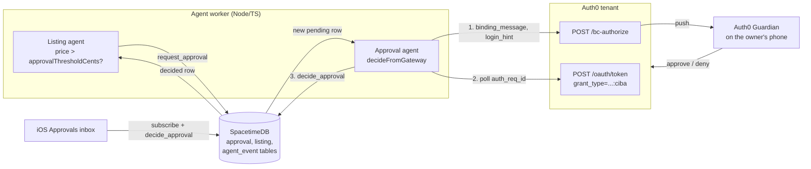

# Moove x Auth0: phone approval for agent actions

Submission notes for the Auth0 (MLH) **Best use of Auth0** track (Cal Hacks 13.0). The rule is "use any Auth0 API". The same text is pasted into Devpost.

## Summary
**Who it's for.** People in the middle of a move who let agents sell and buy for them, but want the final say on anything expensive.

**What it does.** Moove's agents price your stuff, post listings and buy what the new place needs. Below your limit they just do it. Above your limit (`approvalThresholdCents`, $100 by default) the agent stops and asks. The worker sends an Auth0 **CIBA** request, Auth0 Guardian pushes it to your phone ("Moove: sell 420.00 USD: Herman Miller chair", amount first), and the agent waits for your answer. Approve and the listing posts (or the purchase goes through). Deny and it doesn't. The same request also shows up in an in-app Approvals inbox, so there is always a way to answer.

**Auth0 APIs used.**
- **CIBA (Client-Initiated Backchannel Authentication)**, the async authorization flow behind Auth0 for AI Agents, with **Auth0 Guardian push** as the channel. Merged in PR #35. Called with plain `fetch` from `agents/src/integrations/auth0.ts`:
  - `POST https://<AUTH0_DOMAIN>/bc-authorize` with `scope=openid`, a `binding_message`, `login_hint` in `iss_sub` format (the owner's Auth0 user id), `requested_expiry=300` (300 or less selects Guardian push), and `audience` if `AUTH0_AUDIENCE` is set.
  - `POST https://<AUTH0_DOMAIN>/oauth/token` with `grant_type=urn:openid:params:grant-type:ciba` and the `auth_req_id`, polled at the interval Auth0 returns.
- **Login with Universal Login**, merged in PR #25 "Login with Auth0 (#1)". It uses the Auth0.swift SDK (3.1.0, declared in `ios/project.yml`): `Auth0.webAuth(...).scope("openid profile email offline_access")`, a `CredentialsManager` in the Keychain, and `logout`. The ID token becomes the SpacetimeDB connection token, so the user's database identity comes from their Auth0 account, and the app calls `registerUser` with their Auth0 `sub` (`ios/Moove/Features/Auth/AuthGate.swift`). Verified end to end on 2026-10-24: the iPad logged in through Universal Login and the tenant logged the login and code exchange from `Moove 1.0.0 / iOS`.

## How it works
1. The listing agent (`agents/src/agents/listing.ts`) checks a draft listing against the owner's `user.approvalThresholdCents` (fallback `APPROVAL_THRESHOLD_CENTS_DEFAULT`, default 10000 cents). If the price is above it (or the threshold is -1, "always ask"), it calls the `request_approval` reducer (`kind: 'listing'`, `amountCents`, a summary) and sets the listing to `awaiting_approval`.
2. `request_approval` (in `spacetime/src/index.ts`) is worker-only. It inserts an `approval` row with `status: 'pending'`.
3. The approval agent (`agents/src/agents/approval.ts`) sees the new row. If CIBA is configured and the owner's `user.auth0Sub` is set, it builds a binding message with `toBindingMessage` and calls `start()`, which hits `/bc-authorize`.
4. Guardian shows the binding message on the owner's phone.
5. The worker polls `/oauth/token`. `authorization_pending` means keep waiting, `slow_down` means wait longer, `access_denied` means denied, `expired_token` means expired. Auth0 also reports expiry as `access_denied`, so the worker tells expiry from denial by its own clock against the request's `expiresAt`.
6. On success, the worker decodes the returned `id_token` and checks that its `sub` is the user it asked. If not, it ignores the answer. Today a success with no `id_token` is still accepted. PR #58 (open) makes this fail closed: a success counts only if the `id_token`'s `sub` matches, and a missing or undecodable `id_token` is rejected and leaves the approval pending for the inbox. **Pending (PR #58).**
7. The worker records the answer with `decide_approval` (`approved` or `denied`). This happens in exactly one function, `decideFromGateway`.
8. The listing agent sees the decided row. If it is `approved` and the amount still matches the listing price, it posts. Otherwise it sets the listing to `rejected` and logs why (for example "price changed after approval").

Every step writes an `agent_event` row (`agent: 'approval'`, `refTable: 'approval'`), so the app's activity feed shows what happened. Tokens are never stored or logged, and error messages only include Auth0's error code and description.

**The in-app inbox.** `ios/Moove/Features/Approvals/` adds an Approvals tab with a pending badge, approve and deny buttons (deny asks you to confirm), a price-changed warning, and history. It calls the same `decide_approval` reducer on the same `approval` row. Whichever answer lands first wins: `decide_approval` throws `approval already <status>` for a second decision, and the worker checks the row before every poll and stops if the app already decided.

**Fallbacks.** The worker never decides on its own when it has no answer from the phone:
- No CIBA config: approvals stay `pending` for the inbox.
- No `auth0Sub` on the owner's user row: the approval waits for the inbox, and the worker sends the push if the user links Auth0 later. (The simulated approver needs no `auth0Sub`.)
- `/bc-authorize` fails, a poll errors, or the 5-minute request expires: the row stays `pending` for the inbox. The worker does not push again.

## Architecture diagram


ASCII fallback:
```
Listing agent --request_approval--> SpacetimeDB (approval: pending) <--subscribe / decide_approval-- iOS Approvals inbox
                                        |            ^
                              new row   v            | decide_approval (approved | denied)
                                   Approval agent ---+
                                    |        ^
       (1) POST /bc-authorize       |        | (2) poll POST /oauth/token
           binding_message, login_hint       |     grant_type=urn:openid:params:grant-type:ciba
                                    v        |
                                Auth0 tenant --push--> Guardian on the owner's phone
Listing agent sees the decided row: approved + same price -> post; otherwise -> rejected
```

## Controls
- **The agent asks, the human decides.** The worker's only path to `decide_approval` is `decideFromGateway`, and its input always comes from a CIBA poll result (or the opt-in simulated approver below). The worker has no code that approves by itself.
- **Contract enforcement is weaker than that.** `request_approval` is worker-only (`requireWorker`). But `decide_approval` uses `requireOwnerOrWorker`, so the SpacetimeDB module accepts a decision from the row's owner **or from the worker identity**. Segregation of duties is enforced in the worker code, not in the database. Restricting `decide_approval` to the owner would need a contract change, and the worker would then need another way to record CIBA answers. That change is proposed in issue #42 ("Proposal: the worker can't approve its own requests", open).
- **Right user only.** The CIBA request targets the owner's Auth0 `sub`, and the worker rejects an `id_token` whose `sub` doesn't match. Requiring a matching `id_token` on every success is **pending (PR #58)**.
- **Approval is tied to the price.** A listing posts only if the approved `amountCents` equals the current listing price. A purchase is captured only if the approved amount equals the charge, checked again right before capture (#40).
- **Rate limit.** Auth0 allows 5 CIBA requests per user per minute. The worker caps itself at 4 per owner per minute (`approvalTuning`). Requests over the cap are queued, not dropped (`reserveStart` waits for a free slot).
- **Secrets in env only.** `AUTH0_CIBA_CLIENT_SECRET` lives in the gitignored `.env.local` and is never logged. The public Auth0 client ID for the iOS app is allowlisted in `.gitleaks.toml` (PR #43), since a native client ID is not a secret.
- **Simulation is labeled.** `APPROVAL_SIM_AUTO_APPROVE_SEC` (default 0, off) auto-approves after N seconds for demos, but only when Auth0 isn't configured. Every event it causes says "(simulated)" and carries `simulated: true`.

## Setup
The full steps are in `docs/tasks/12-phone-approval-auth0.md`. In short:
1. In the same Auth0 tenant as the iOS login, create a Regular Web Application (`moove-worker`) and enable the **Client Initiated Backchannel Authentication (CIBA)** grant. Enable the Guardian push channel in its CIBA settings.
2. Enable **Push Notification using Auth0 Guardian** under Multi-factor Auth, install Guardian on the demo phone, and enroll the demo user.
3. Make sure the user's `user.auth0_sub` in SpacetimeDB is their Auth0 user id (for example `auth0|abc...`).
4. In the repo root `.env.local`:
```
AUTH0_DOMAIN=...
AUTH0_CIBA_CLIENT_ID=...
AUTH0_CIBA_CLIENT_SECRET=...
AUTH0_AUDIENCE=                    # optional
APPROVAL_THRESHOLD_CENTS_DEFAULT=10000
APPROVAL_SIM_AUTO_APPROVE_SEC=0
```
5. Restart the worker. It logs the mode it picked, for example `[approval] Auth0 CIBA via Guardian push (tenant ...)` or `[approval] Auth0 not configured: approvals wait for the in-app inbox`.

`AUTH0_CLIENT_ID` / `AUTH0_CLIENT_SECRET` belong to the iOS app and can't run CIBA. The worker uses its own confidential client.

To reuse the CIBA client elsewhere, copy `agents/src/integrations/auth0.ts`. It has no dependencies beyond `fetch` and exposes `auth0CibaGateway(cfg)` with `start()` and `poll()`, plus `toBindingMessage()`.

## Known limitations
- **Verified against the real tenant (2026-10-24).** Tenant `dev-78lq8spq27b2bipk` (on the Auth0 trial, which offers the CIBA grant) has a `moove-worker` Regular Web App with the CIBA grant and the Guardian Push channel, and Guardian push enabled under MFA. `npm run auth0:ciba-test -- '<auth0 user id>' [dollars]` (in `agents/`) sends one push through the same gateway and prints `approved`/`denied`/`expired`. Then the full flow ran on the maincloud worker: a listing over the threshold, a Guardian push to the owner's enrolled iPad, approved on the device, and a successful CIBA token exchange (all in the tenant's logs). A `Failed CIBA Start: Unauthorized` in those logs means the worker's client secret is wrong.
- **The owner must log into the app with Auth0, not as Guest.** `register_user` takes `auth0Sub` only from the caller's verified token, so a Guest owner has no Auth0 account to push to, and their approvals wait for the in-app inbox. The owner also needs Guardian enrolled (Users → user → Send an enrollment invitation).
- **Callback URLs are per bundle id.** A personal build (`app.moove.Moove.<name>`) fails login with "Callback URL mismatch" until its callback and logout URLs are added to the Moove iOS application.
- **The live in-app decision is a stub.** In the iOS app, `decideApproval` (and `registerUser`) in `ios/Moove/Sync/SpacetimeBackend+Contract.swift` still throw until the Swift bindings are generated. The inbox works end to end only in fixture (demo) mode today.
- **Purchase approvals have not been run against a real tenant either.** The buy agent (`agents/src/agents/buy.ts`, merged in PR #40) calls `request_approval` with `kind: 'purchase'` (summary `Pay $X to <merchant> for: <title>`), and the push reads "Moove: buy 179.99 USD: <deal title>", using the deal row's title (PR #53). The same CIBA and inbox paths decide it, and the Visa checkout re-checks the approved amount right before capture (see `docs/visa.md`). On the phone, purchase approvals run in Offline demo mode until the live bindings land.
- **Segregation of duties is enforced in the worker, not the contract** (see Controls; proposal in issue #42).
- **The `id_token` is decoded, not signature-checked.** It comes straight from the tenant's token endpoint over TLS in reply to an authenticated client request. Until PR #58 merges, the `sub` check only runs if the response includes an `id_token`.
- **One push per approval per worker run.** After an expiry or error the worker doesn't push again, and the inbox is the way to answer. That bookkeeping lives in memory, so a worker restart sends a new push for every approval still `pending`.

## Devpost block
- *Summary:* Moove's agents sell and buy for you during a move. When an agent wants to do something over your limit (`approvalThresholdCents`, $100 by default), it can't. It files an approval request, and the worker sends an Auth0 CIBA request with a binding message like "Moove: sell 420.00 USD: Herman Miller chair" to your phone via Auth0 Guardian push. Approve and the listing posts. Deny and it doesn't. An in-app Approvals inbox resolves the same request as a backup. Every step is logged live.
- *Auth0 APIs:* CIBA (`/bc-authorize` + `/oauth/token` with `urn:openid:params:grant-type:ciba`, Guardian push, `iss_sub` login hint). Login with Universal Login via Auth0.swift (merged, PR #25).
- *Repo + setup:* https://github.com/christianazinn/moove, see "Setup" in `docs/auth0.md` and `docs/tasks/12-phone-approval-auth0.md`. Code: `agents/src/integrations/auth0.ts`, `agents/src/agents/approval.ts`.
- *Status:* Live. Login through Universal Login and CIBA with Guardian push both run against the real tenant: an over-threshold listing pushed to the owner's iPad, was approved there, and the worker recorded the decision.
