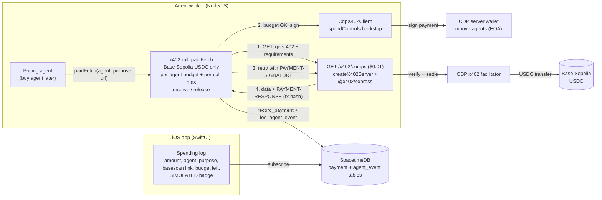

# Moove x Coinbase: x402 payment agents

Submission notes for the Coinbase **Best Use of x402 / Payment Agents** track (Cal Hacks 13.0). The same text is pasted into Devpost.

## Summary
**Who it's for.** People in the middle of a move. Pricing, selling, buying and paying for a whole household is hours of tedious work, so Moove hands it to agents. The user stays in control: they set the limits, approve anything big, and watch every cent the agents spend.

**What it does.** Moove is an iOS app. You scan your room and agents inventory, price and sort your stuff, then sell, buy and pay on your behalf. When an agent needs paid data (for example a premium comps report to price an item), it pays for it itself, per call, over **x402** with USDC on Base Sepolia. A payment rail sits between the agents and the wallet. It enforces a per-agent budget and a per-call max before anything is signed. Every step and every payment is written to SpacetimeDB, and the app shows them in a live spending log with a basescan link for each transaction.

**Coinbase tools used.**
- `@coinbase/cdp-sdk` 1.60.0
  - `CdpX402Client` is the buyer. It signs with a CDP server wallet (EOA) named `moove-agents`, and its `spendControls` are set as a backstop.
  - `createX402Server` is the seller. It paywalls our comps endpoint and provisions the receiver wallet.
  - `CdpClient.evm.requestFaucet` funds the wallet with testnet USDC.
  - `listTokenBalances` shows the wallet's balance.
- x402 v2 packages at 2.28.0: `@x402/core` (we use `x402HTTPClient` to drive the 402 flow by hand), `@x402/express` (`paymentMiddlewareFromHTTPServer`), plus `@x402/evm`, `@x402/svm` and `@x402/extensions`.
- The CDP facilitator verifies and settles payments on **Base Sepolia** (`eip155:84532`) in USDC (`0x036CbD53842c5426634e7929541eC2318f3dCF7e`).

## How it works
1. An agent (the pricing agent today, the buy agent later) calls `rail.paidFetch({ owner, agent, purpose, refTable, refId }, url)`.
2. The rail makes the request. If the server answers `402 Payment Required`, it decodes the payment requirements with `x402HTTPClient.getPaymentRequiredResponse`.
3. It keeps only options that pay **Base Sepolia USDC**, and picks the cheapest. A server offering anything else is refused and the refusal is logged.
4. **Before signing**, it reserves the amount in the agent's budget. The reservation fails if the amount is over the per-call max (`X402_MAX_PER_CALL_USDC`, default $0.10) or would push the agent past its cap (`AGENT_SPEND_CAP_USDC`, default $5). A refusal throws `SpendRefusedError` and writes an `agent_event` row with `refused: true`, and nothing is signed.
5. `CdpX402Client` signs only the option we budgeted for, using the `moove-agents` CDP wallet. The rail retries the request with the `PAYMENT-SIGNATURE` header.
6. The seller (`createX402Server` + `@x402/express`) has the CDP facilitator verify and settle the payment on Base Sepolia, then returns the data with a `PAYMENT-RESPONSE` header.
7. The rail decodes the settlement (`getPaymentSettleResponse`) to get the **tx hash**, writes a `payment` row (`rail=x402`, amount, payee, txHash, status, `simulated`), and writes a `payment` agent event with the basescan link. If anything fails, it releases the reservation and logs an `error` event.
8. The iOS app subscribes to the `payment` and `agent_event` tables, so the spending log updates live (PR #36).

We drive the 402 flow by hand instead of using `wrapFetchWithPayment`. That way every call carries its agent and purpose, and our budget check happens before signing. The client-wide SDK hooks can't do either per request.

The comps endpoint (`GET /x402/comps?q=...`, $0.01) is hosted by our own worker code (`agents/src/paywall.ts`, served on `127.0.0.1:8402` by `agents/src/integrations/paid-comps.ts`) and backed by the Apify comps lookup, so the payment flow is real end to end. **The pricing agent buys every item's comps from it** (PRs #37, #46): each pricing run is one $0.01 x402 payment and one `payment` row. Payments never block pricing. If the rail refuses (over budget) or the paid call fails, pricing logs the fallback and calls Apify directly (unpaid). If the paywall can't start at all (port taken, CDP outage), the worker logs it and keeps pricing on direct lookups. `PRICING_PAY_X402=0` turns the paid path off. No third-party x402 data service fit our use case. It pays from `0x3224220E5007e8F4c0440447bdfeb846c96f8A52` (the agents' wallet) to `0x6644b110FD0B1671599E36db749d09b1EAeEF952` (the receiver wallet).

## Architecture diagram


ASCII fallback:
```
iOS app (spending log) <--live subscription-- SpacetimeDB (payment, agent_event)
                                                   ^
                                                   | record_payment / log_agent_event
Agent worker                                       |
  pricing agent --paidFetch--> x402 rail ----------+
                                 |  ^  (1) GET -> 402 + requirements
     (2) budget + per-call check |  |  (4) 200 + PAYMENT-RESPONSE (tx hash)
         then sign               v  |
  CdpX402Client -> CDP wallet  GET /x402/comps ($0.01, createX402Server)
  "moove-agents"                     | (3) verify + settle
                                     v
                        CDP facilitator --> Base Sepolia USDC
```

## Controls
- **Spend caps, enforced before signing.** There's a per-agent budget (`AGENT_SPEND_CAP_USDC`, default $5) and a per-call max (`X402_MAX_PER_CALL_USDC`, default $0.10). Amounts are reserved before signing and released on failure, so concurrent calls from one agent can't overspend (there's a test for this). Over-cap calls are refused and logged as `agent_event` rows that the app shows.
- **Asset, network and payee allowlist.** The rail only pays USDC on Base Sepolia, and with `X402_ALLOWED_PAYEES` set (comma-separated) it refuses any `payTo` outside the list. The SDK's `spendControls` (per-payment max, a 24h cumulative cap, allowed networks and assets) sit underneath as a backstop.
- **Human approval for big spends.** Purchases or listings above the user's `approvalThresholdCents` create an `approvals` row and need an Auth0 async authorization (CIBA) on the phone first (task #12). x402 data calls stay far below that threshold, and the per-call max keeps them there.
- **Simulated labeling.** With no CDP keys, or with `X402_SIMULATE=1`, the rail signs nothing. Every `payment` row has `simulated: true`, every event message starts with `[SIMULATED]`, and the app shows a SIMULATED badge. Simulated payments are never shown as real.
- **Keys in env only.** CDP keys live in the gitignored `.env.local` or in the worker's environment, never in git. CI runs gitleaks. The wallet is a CDP server wallet, so its private keys never touch our machines.
- **Full audit trail.** Every step (tool call, payment, refusal, error) is an `agent_event` row, and every payment is a `payment` row with its tx hash.

## Setup
Requires Node 22+ and a CDP API key and wallet secret from https://portal.cdp.coinbase.com.

```sh
cd agents && npm ci
npm test                           # x402 rail tests: caps, refusals, concurrency, settlement, simulated mode
X402_SIMULATE=1 npm run x402:demo  # one paid comps call on the simulated rail (no keys needed)
```

For real testnet payments, copy `.env.example` to `.env.local` at the repo root and fill in:
```
CDP_API_KEY_ID=...
CDP_API_KEY_SECRET=...
CDP_WALLET_SECRET=...
AGENT_SPEND_CAP_USDC=5
X402_MAX_PER_CALL_USDC=0.10
X402_ALLOWED_PAYEES=           # optional payTo allowlist (empty = any address, still capped)
X402_SEED_BUDGETS=1            # count the last 24h of payments against each budget at startup (0 = start at zero)
PRICING_PAY_X402=1             # pricing buys comps over x402 (0 = direct Apify lookups)
```
Then, from `agents/`:
```sh
npm run x402:wallet -- --faucet    # creates/loads the moove-agents wallet, funds it with testnet USDC, prints balances
npm run x402:demo                  # starts the paywalled comps endpoint, pays it over x402, prints the basescan link
npm start                          # the worker: the pricing agent now pays $0.01 per item for comps over the same rail
```

To reuse the rail in another project, copy `agents/src/integrations/x402.ts` and implement `PaymentSink` (two methods: `recordPayment` and `logAgentEvent`) for your own storage. `agents/src/payments.ts` is our SpacetimeDB version.

## Proof
A real x402 payment of 0.01 USDC from the agents' CDP wallet to the comps paywall settled on Base Sepolia in block 49461682:
https://sepolia.basescan.org/tx/0xc7942646380456c56dde204434aeb6115338b521b6e91a0901ec05dde1fe136c

That payment was made by `npm run x402:demo`. The pricing agent's payments in the worker go through the same rail and paywall, and each one lands as a `payment` row with its tx hash, shown in the app's spending log.

## Known limitations
- **Testnet only** (Base Sepolia, testnet USDC).
- **One shared wallet for all agents.** Per-agent budgets are enforced in the worker process, not on-chain. A bug in the worker could bypass them. Only the SDK `spendControls` backstop would still apply.
- **Budgets are tracked in the worker.** The spend ledger lives in memory. On startup it is seeded from the last 24h of `payment` rows (`X402_SEED_BUDGETS=1`, the default), so a restart doesn't reset an agent's budget, but the window is rolling rather than a fixed period.
- **The comps endpoint is our own paywall.** No third-party x402 data service fit, so we pay ourselves. The flow and settlement are real, but the money goes between two of our own wallets.
- **Only the pricing agent pays over x402 so far.** It buys its comps through the paywall (#46). If a payment fails it falls back to a direct (unpaid) Apify lookup, so not every pricing run is guaranteed to produce a payment. The buy agent doesn't use the rail yet.
- **The live iOS backend glue is pending** (#10), so the in-app spending log currently runs in Offline demo mode.

## Builder feedback
**Biggest blocker: installing and type-checking the CDP x402 packages.**
1. `@coinbase/cdp-sdk/x402` imports `@x402/evm`, `@x402/svm` and `@x402/extensions` at runtime, but they are declared as *optional* peer dependencies. A plain `npm install @coinbase/cdp-sdk` crashes on import with `ERR_MODULE_NOT_FOUND`. **Workaround:** install all of them explicitly (as the quickstart does) and pin them to the same version (2.28.0).
2. The cdp-sdk package has no `"type": "module"`, so TypeScript resolves `@x402/core`'s CJS declarations through cdp-sdk's `.d.ts`, while `@x402/express` gets the ESM declarations. The `X402Server` from `createX402Server` is then "not assignable" to `x402HTTPResourceServer` (two declarations of the same private member). **Workaround:** one commented cast in `agents/src/paywall.ts`, because it's the same class at runtime.

**Other friction, in order of pain:**

3. The docs don't say how a buyer gets the settlement result or tx hash. The quickstarts only check the HTTP status. We found `decodePaymentResponseHeader`, `x402HTTPClient.getPaymentSettleResponse` and the `PAYMENT-RESPONSE` header by reading the type definitions.
4. The README and our brief pointed to `x402-fetch` (v1, stale since April), while v2 is `@x402/*`. Package naming across v1 and v2 is confusing.
5. Client hooks like `onBeforePaymentCreation` apply to the whole client, not per request, so per-agent budgets meant driving the 402 flow by hand.
6. The server-side `createX402Server` registers the Bazaar discovery extension automatically, and it logs a rejection for every non-HTTPS (localhost) resource. That's noisy in development.
7. The CDP policy engine can't cap x402 amounts, and its USD limit is ignored on testnet, so spend caps have to live in the app.

**The missing capability we want most:** per-request spend context and limits in the SDK. That means a budget per agent or sub-account with built-in reserve and release, plus a first-class `paidFetch` that returns the settlement and tx hash along with the response. Our ~350-line rail (`agents/src/integrations/x402.ts`) is basically that, and every multi-agent app will need to write it again.
