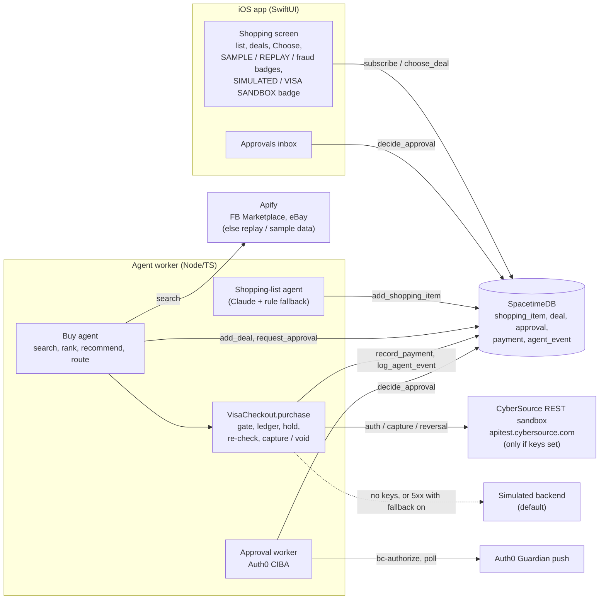

# Moove x Visa: agent shopping with a guarded checkout

Submission notes for the Visa **Reimagining Shopping** track (Cal Hacks 13.0). Sections follow the judging weights: innovation 25%, UX 25%, technical execution 20%, commerce impact 15%, trust and responsibility 15%.

> **Status.** The shopping list, buy agent, Visa checkout and iOS Shopping screen are merged (PR #40). So are the approval flow (Auth0 CIBA + in-app inbox, PR #35) and the x402 spend caps (PR #23).
>
> **The demo checkout is a labeled simulation.** We tried a real CyberSource sandbox charge with real sandbox keys (`npm run visa:demo -- 1.00`, Oct 24). Both attempts got **HTTP 502** (`status: SERVER_ERROR`, `reason: SYSTEM_ERROR`, CyberSource request id `7928175635416253203813`). Nothing was authorized or captured. The HTTP Signature was accepted (a bad signature returns 401), so this most likely means the sandbox account has no card processor enabled. Until that is fixed, every purchase runs on the simulated backend and is labeled SIMULATED.

## Summary
**Who it's for.** People moving into a new place. You arrive needing a mattress, a sofa and a desk chair, and you have no time to compare listings.

**What it does.** When you add your new home, an agent writes a "still need to buy" list: what the rooms need, minus the things you are keeping. A buy agent searches deals for each item, ranks them and recommends one. You choose a deal in the app (or let the agent choose, with `BUY_AUTO_CHOOSE=1`) and the agent checks out by card. At or under your approval threshold it buys right away. Above it, it asks you first, on your phone. Every step is logged and shown in the app, and nothing simulated is ever shown as real.

**Visa tools used.**
- **Visa Acceptance (CyberSource) REST sandbox**, called directly with HTTP Signature auth (no SDK dependency). It places an authorization hold on the public Visa test card, then captures it or reverses it. The real sandbox charge has not succeeded yet (502, see above).
- **Visa Intelligent Commerce (VIC)** was not available to us. Its credentials (API key, MLE keys, VTS token requestor, consumer and enrollment IDs) come only through Visa onboarding. So `VISA_PROVIDER=vic` is a documented seam: `createVicBackend` throws, and the checkout falls back to simulated. Each purchase still records a VIC-shaped mandate (see Trust).

## How it works
1. **Shopping list.** `agents/src/agents/shopping.ts` runs when a `new_home` row appears and the owner has no shopping items. Claude (`MODEL_AGENT`, `structuredCall`) lists what the rooms still need, minus the owner's `keep` items. A rule-based list is the fallback. Each item is added with `add_shopping_item`.
2. **Deals.** `agents/src/agents/buy.ts` searches deals for each open item through `createDealSource` (`agents/src/integrations/deals-apify.ts`). With `DEALS_SOURCE=apify` (the default), it uses three sources, in this order:
   - live FB Marketplace and eBay Buy It Now listings through Apify (`DEALS_APIFY_SOURCES`, default `fb,ebay`, with Craigslist opt-in), cached under `agents/.cache/deals/`;
   - without `APIFY_TOKEN`, committed live searches (`agents/fixtures/deals-live-*.json`, labeled "cached replay");
   - otherwise, hand-made sample data (`agents/fixtures/deals.json`, labeled "sample data").

   Live and replayed results always include the matching sample retail rows, so every item has a card-checkout option. At most `DEALS_SEARCH_CONCURRENCY` (2) items search at once.
3. **Rank and recommend.** `rankDeals` scores price (50%), condition (25%), distance (15%) and a card-checkout bonus (10%). An unknown pickup distance is shown as "distance unknown", never as a made-up number. The agent writes the top 5 with `add_deal`. The best deal it can pay by card (`ikea`, `target`, `amazon`, `wayfair`) is always among them and becomes the recommendation.
4. **Choose and route.** The user chooses a deal in the app (`choose_deal`). With `BUY_AUTO_CHOOSE=1` the agent chooses its recommendation instead. A deal with a fraud score at or above `BUY_FRAUD_BLOCK` (0.7) is never bought. Marketplace sellers (FB, Craigslist) can't be paid through an API, so the agent drafts a message to the seller. Card merchants go to Visa checkout.
5. **Approval.** The card caps are checked first, so you are never asked to approve something that would be refused. Above the owner's `approval_threshold_cents` (or when it is -1, "always ask"), the agent calls `request_approval` (kind `purchase`, ref = deal ID, summary `Pay $X to <merchant> for: <title>`) and waits. The CIBA worker or the in-app inbox decides it (#35). The phone push reads "Moove: buy 179.99 USD: <deal title>" (#53).
6. **Checkout.** `VisaCheckout.purchase()` in `agents/src/integrations/visa.ts` runs these steps in order:
   - the approval gate
   - the spend ledger
   - the authorization hold (`POST /pts/v2/payments`, `capture: false`)
   - a re-check
   - capture (`/captures`), or reversal (`/reversals`) if any step fails
7. **Record.** Each authorization writes a `payment` row (rail `visa`, pending, then settled or failed). Each step writes an `agent_event`. The item moves to `bought` after capture. A temporary error is retried up to 3 times (`BUY_RETRY_DELAY_MS`, default 60 s, growing each time), with the budget released and nothing charged in between.

## Architecture diagram


ASCII fallback:
```
iOS Shopping screen + Approvals inbox <--subscribe-- SpacetimeDB
                                                      ^   (shopping_item, deal, approval,
                                                      |    payment, agent_event)
Agent worker                                          |
  shopping-list agent --add_shopping_item-------------+
  buy agent --search--> Apify (else cached replay, else sample data)
  buy agent --add_deal / request_approval-------------+
     |                                                |
     v                                                |
  VisaCheckout.purchase: gate -> ledger -> hold ------+ record_payment / log_agent_event
     -> re-check -> capture | reversal
     |-- keys set:  CyberSource REST sandbox (test card)
     '-- no keys:   simulated backend (simulated: true)
  approval worker (#35) --CIBA--> Auth0 push --> decide_approval
```

## Innovation
- The buy list comes from the move itself: the new home's rooms minus what you are keeping. You are not shown things you already own.
- One agent handles both kinds of seller. Retail merchants get a card checkout. Marketplace sellers get a drafted message, because no API can pay them.
- Each purchase carries a VIC-shaped mandate (max amount, merchant, expiry, consumer prompt), so the flow maps onto VIC purchase instructions once credentials exist.

## User experience
- The iOS Shopping tab (`ios/Moove/Features/Shopping/`) shows:
  - the list, with add and swipe-to-remove
  - the deals for each item, with SAMPLE, REPLAY and fraud badges
  - Choose
  - Approve/Deny for purchase approvals ("Over your approval limit. The agent pays with Visa only after you approve.")
  - Visa payment rows
- Sellers are shown as "FB Marketplace seller, <city>" or "eBay seller". FB seller names are private individuals, so they are never read or stored.
- Payment badges: an orange **SIMULATED** badge for simulated rows, and **VISA SANDBOX** for real sandbox rows.
- Choose is locked while a hold or a purchase approval is pending for that item (`isCheckoutLocked`).
- The live SpacetimeDB reducers for shopping are stubbed until the Swift bindings land (#10). So the full Choose, approve, checkout flow on the phone runs in Offline demo mode today. The worker side runs live.

## Technical execution
- HTTP Signature signing (`cybersourceSignedHeaders`) uses the same signing string as `cybersource-rest-client@0.0.84`: host, date, request-target, digest (POST only) and v-c-merchant-id, then HMAC-SHA256 with the base64-decoded secret.
- **A broken integration is never hidden behind a simulated label.**
  - These fail the checkout with an `error` event: a 401/403 from CyberSource, or `VISA_PROVIDER=acceptance` with missing keys or a host other than the sandbox.
  - A 5xx or network error falls back to the simulated backend, for that one purchase, in two cases: `VISA_FALLBACK_SIMULATED=1`, or no `VISA_PROVIDER` set (backend picked from the keys). Otherwise it is a retryable failure.
- Holds remember which backend placed them, so a capture or reversal always goes to the right one. A hold can be closed only once.
- A capture that fails in transit is not voided, and its budget is not released. The payment stays pending and is flagged for reconciliation, which blocks a repeat purchase. Only one purchase per shopping item is allowed.
- `agents/test/visa.test.ts` covers signing, a fake CyberSource server, declines, the approval gate, the ledger (including concurrent purchases), fallback and reconciliation. `agents/test/buy.test.ts` covers the buy agent.

## Commerce impact
- Furnishing a new place means a burst of purchases at a stressful time. Moove turns it into a list you review and approve, instead of a weekend of browsing.
- Merchants get a buyer agent that pays by card under a clear, bounded mandate, instead of a scraper.
- Honest scope:
  - Live deals are verified for one item. A real Apify run for the demo "Mattress" item returned 9 active listings (4 FB Marketplace, 5 eBay), committed as `agents/fixtures/deals-live-mattress.json` and replayed with a REPLAY label. Every other item uses sample data until it is searched live with `APIFY_TOKEN`.
  - A sandbox charge would go to our own sandbox merchant, standing in for the retailer (the payee reads "Visa Acceptance sandbox merchant (for ikea)").

## Trust and responsibility
- **Approval above the threshold.**
  - An `approval` row triggers an Auth0 CIBA push, and the iOS Approvals inbox can also decide it (#35).
  - `approvalGate` requires an `approved` approval when the price is over `approval_threshold_cents` (default `APPROVAL_THRESHOLD_CENTS_DEFAULT`, 10000 = $100) or the threshold is -1.
  - The buy agent never calls `decide_approval` itself.
  - A denied or expired approval sticks, even if the threshold is raised later.
- **Approved amount re-checked before capture.**
  - The gate requires `approval.amountCents` to equal the purchase amount exactly.
  - It runs three times: before the hold, in `purchase()` after the hold, and inside `capture()` on the hold's own amount. So calling `capture()` directly can't skip it.
  - Each check reads the approval and the threshold fresh.
  - `stillValid` also aborts if the user picked another deal, the item or deal was removed, or the fraud score crossed the block line.
  - Any failed check reverses the hold instead of capturing.
- **Spend caps.**
  - `CardSpendLedger` reserves budget before the hold. There is a per-agent cap (`VISA_SPEND_CAP_USD`, default 1500) and a per-purchase max (`VISA_MAX_PER_PURCHASE_USD`, default 750).
  - Budget comes back only after a confirmed reversal or a decline.
  - At startup the cap is seeded from the last 24 h of non-simulated (sandbox or real) card payments, so a restart doesn't reset it. Simulated rehearsals never count. `VISA_SEED_BUDGETS=0` turns seeding off.
  - x402 data calls have their own caps (`AGENT_SPEND_CAP_USDC`, `X402_MAX_PER_CALL_USDC`, see `docs/coinbase-x402.md`). The per-agent budgets in the app's Spending screen are x402-only; card spend shows in the per-rail totals.
- **Fraud screen: pending (#18).**
  - The buy agent already refuses deals with `fraudScore >= BUY_FRAUD_BLOCK`, and the app shows fraud chips and reasons.
  - No fraud agent exists yet (issue #18 is open), so every live deal keeps the default score of -1. The fraud scores in the app's Offline demo are fixture values.
  - With `BUY_REQUIRE_FRAUD_SCORE=0` (the default), unscored deals can be bought, and the plan event says "Not fraud-screened yet."
- **Simulated labeling.**
  - Simulated rows have `simulated: true`, their messages start with `[SIMULATED]`, and the app shows the SIMULATED badge.
  - Sandbox rows are `simulated: false`, with `sandbox: true` in the event data. Their purposes start with `[Visa sandbox]`, their messages with `[VISA SANDBOX]`, and the app shows VISA SANDBOX.
  - Deal rows say "sample data" (SAMPLE) or "cached replay" (REPLAY) when they aren't live.
- **Sandbox only, test card only.** `createAcceptanceBackend` refuses any host other than `apitest.cybersource.com`. The only card is the public Visa test card. The app never takes card numbers.
- **Agent reasoning log.** Every step is an `agent_event` row, and the mandate rides in the event data. That includes the plan, search, ranking with reasons, recommendation, approval request, hold, capture, reversal, refusal, retry and error.
- **Scraped text is data.** Deal text is sanitized (`sanitizeText`) and never put into a Claude prompt. The approval summary puts the amount first and strips `"` and `$` from titles, so a listing title can't fake the price.

## Setup
Requires Node 22+. From `agents/`:
```sh
npm ci && npm run typecheck && npm test
VISA_PROVIDER=simulated npm run visa:demo -- 129.99   # one labeled simulated checkout, no keys needed
```
`visa:demo` runs one checkout without SpacetimeDB and prints the payment row and every event (default amount $42.50). It pretends the user approved exactly that amount.

For the CyberSource sandbox, sign up at https://developer.cybersource.com/hello-world/sandbox.html, generate a REST shared secret key, and make sure the sandbox merchant has a card processor configured. Then put these in `.env.local`:
```
VISA_PROVIDER=acceptance
VISA_ACCEPTANCE_MERCHANT_ID=...
VISA_ACCEPTANCE_KEY_ID=...
VISA_ACCEPTANCE_SECRET=...
VISA_ACCEPTANCE_HOST=apitest.cybersource.com
```
Run `npm run visa:demo -- 1.00` once to check it. With no `VISA_PROVIDER`, the backend is `acceptance` if all three keys are set, and simulated otherwise.

Other settings in `.env.example`:
- `VISA_FALLBACK_SIMULATED`, `VISA_SPEND_CAP_USD`, `VISA_MAX_PER_PURCHASE_USD`, `VISA_SEED_BUDGETS`, `VISA_SIM_DELAY_MS` (400)
- `BUY_AUTO_CHOOSE` (0), `BUY_FRAUD_BLOCK` (0.7), `BUY_REQUIRE_FRAUD_SCORE` (0), `BUY_RETRY_DELAY_MS` (60000)
- `DEALS_SOURCE`, `DEALS_APIFY_SOURCES`, `DEALS_SEARCH_CONCURRENCY`, `DEALS_PER_SOURCE` (6), `DEALS_HOME_LAT` / `DEALS_HOME_LNG`

## Known limitations
- **The real sandbox charge hasn't succeeded.** CyberSource returned HTTP 502 `SYSTEM_ERROR` (request id `7928175635416253203813`), likely because the sandbox account has no card processor enabled. The demo uses the labeled simulation. Don't set `VISA_PROVIDER=acceptance` for a demo until a `visa:demo -- 1.00` run succeeds, or every checkout fails.
- **VIC is not implemented.** Credentials are gated, so `vic` is a seam that falls back to simulated. The mandate is only logged, not enforced by Visa. Our code does not check its 24-hour `effectiveUntil`.
- **Live deals are verified for the mattress only.** Other items use labeled sample data until searched live.
- **No fraud screen yet** (#18). Unscored deals can be bought by default.
- **The card budget lives in the worker.** It is per agent name rather than per user, and it is enforced in our code, not by the processor.
- **The phone runs the shopping flow in Offline demo mode** until the live Swift bindings land (#10).
- **Bought items don't appear in the new-home layout** (#14) yet.

## Devpost block
- **Track:** Visa, Reimagining Shopping.
- **What:** Moove's buy agent turns your new home's rooms, minus what you keep, into a shopping list. It ranks live and replayed deals and checks out by card for the deal you choose, asking for approval on your phone above your threshold.
- **Visa tooling:** Visa Acceptance (CyberSource) REST sandbox: an auth-only hold on the Visa test card, then capture or reversal, with HTTP Signature auth. VIC credentials were gated, so each purchase carries a VIC-shaped mandate instead. Our real sandbox attempt returned a 502 (account provisioning), so the demo checkout is a labeled simulation.
- **Trust:** Auth0 CIBA approval above `approvalThresholdCents`, the approved amount re-checked right before capture, per-agent and per-purchase card caps, a broken integration never disguised as a simulation, and every step logged as an `agent_event`. Fraud screening is planned (#18).
- **Repo:** https://github.com/christianazinn/moove, see `docs/visa.md` (code: `agents/src/integrations/visa.ts`, `agents/src/agents/buy.ts`).
