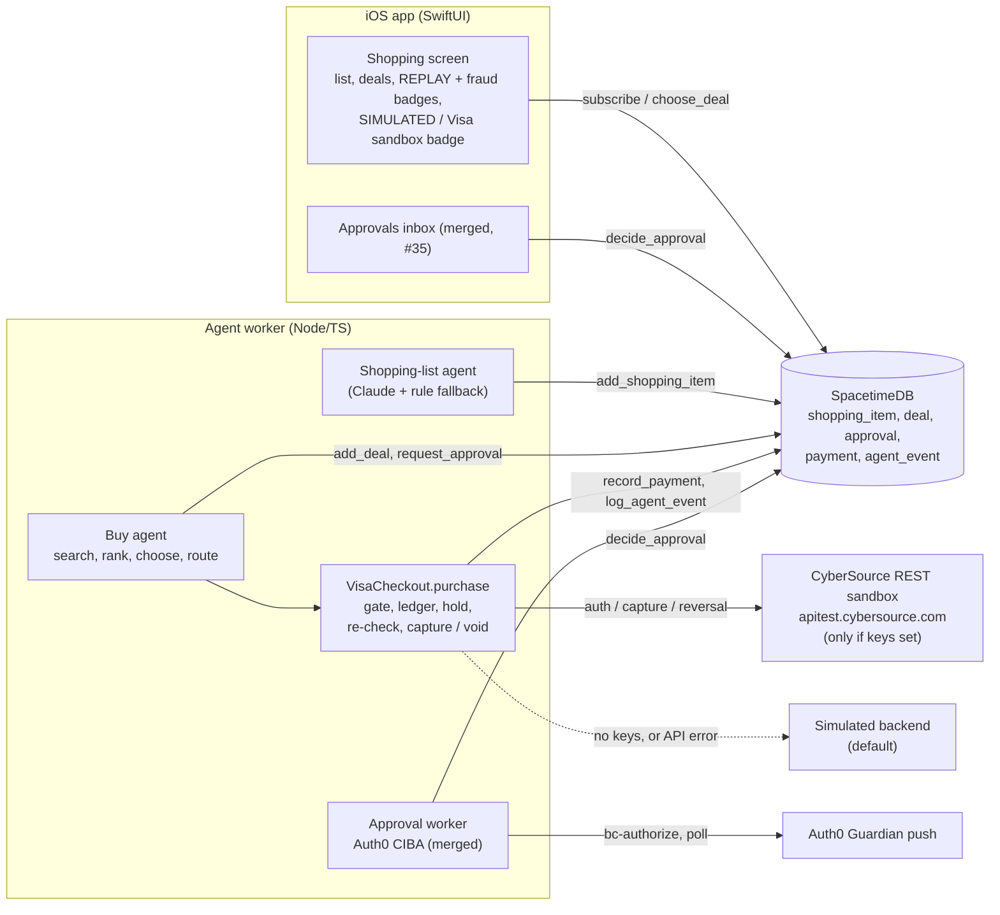

# Moove x Visa: agent shopping with a guarded checkout

Submission notes for the Visa **Reimagining Shopping** track (Cal Hacks 13.0). Sections follow the judging weights: innovation 25%, UX 25%, technical execution 20%, commerce impact 15%, trust and responsibility 15%.

> **Status: the checkout code is pending (PR #40).** The shopping list, buy agent, Visa checkout and iOS Shopping screen live in draft PR #40 (branch `aiden/15-visa-checkout`), which is not merged into `main`. Everything marked **pending (PR #40)** below describes that branch. The approval flow (Auth0 CIBA + in-app inbox, PR #35) and the x402 spend caps (PR #23) are already on `main`.
>
> **Checkout is simulated unless CyberSource sandbox keys are set.** The sandbox backend is built and tested against a fake server, but it has **not been run against the real CyberSource sandbox**. We have no sandbox keys yet, so there is no real sandbox transaction ID to show.

## Summary
**Who it's for.** People moving into a new place. After the move you need a bed frame, a desk, a shower curtain, and you have no time to compare listings.

**What it does.** When you add your new home, an agent writes a "still need to buy" list from the rooms, minus the things you are keeping. A buy agent finds deals for each item, ranks them, recommends one, and checks out for you by card. Under your approval threshold it buys on its own. Above it, it asks you first, on your phone. Every step is logged and shown in the app, and nothing simulated is ever shown as real.

**Visa tools used.**
- **Visa Acceptance (CyberSource) REST sandbox**, called directly with HTTP Signature auth (no SDK dependency). Authorization hold on the public Visa test card, then capture or authorization reversal. **Pending (PR #40), unverified against the real sandbox.**
- **Visa Intelligent Commerce (VIC)** was not available to us. Its credentials (API key, MLE keys, VTS token requestor, consumer and enrollment IDs) come only through Visa onboarding. So `VISA_PROVIDER=vic` is a documented seam (`createVicBackend` throws and falls back to simulated). We do record a VIC-shaped mandate with each purchase (see Trust).

## How it works (pending, PR #40)
1. **Shopping list.** `agents/src/agents/shopping.ts` runs when a `new_home` row appears and the owner has no shopping items. Claude (`MODEL_AGENT`, `structuredCall`) lists what the rooms still need, minus the owner's `keep` items. A rule-based list is the fallback. Each item goes in through `add_shopping_item`.
2. **Deals.** `agents/src/agents/buy.ts` searches deals for each open item through the `DealSource` interface (`agents/src/integrations/deals.ts`). Today that is `fixtureDealSource()`, a hand-curated replay of `agents/fixtures/deals.json`, labeled "cached replay" in every event and as REPLAY in the app. `rankDeals` scores price (50%), condition (25%), distance (15%) and a card-checkout bonus (10%). The top 5 are written with `add_deal`.
3. **Recommend.** The agent picks the best deal it can pay by card (`ikea`, `target`, `amazon`, `wayfair`) and calls `choose_deal`. The user can pick another one in the app. `BUY_AUTO_CHOOSE=0` turns the recommendation off.
4. **Route.** For the chosen deal: if the fraud score is at or above `BUY_FRAUD_BLOCK` (0.7), it is not bought. Marketplace sellers (FB, Craigslist) can't be paid through an API, so the agent drafts a message to the seller instead. Card merchants go to Visa checkout.
5. **Approval.** Above the owner's `approval_threshold_cents` (or when it is -1, "always ask"), the agent calls `request_approval` (kind `purchase`, ref = deal ID) and waits. The CIBA worker or the in-app inbox decides it (merged, #35).
6. **Checkout.** `VisaCheckout.purchase()` in `agents/src/integrations/visa.ts` runs: approval gate, spend ledger, authorization hold (`POST /pts/v2/payments`, `capture: false`), re-check, then capture (`/captures`) or reversal (`/reversals`).
7. **Record.** Each authorization writes a `payment` row (rail `visa`, pending, then settled or failed). Each step writes an `agent_event`. The item moves to `bought` after a capture.

## Architecture diagram


ASCII fallback:
```
iOS Shopping screen + Approvals inbox <--subscribe-- SpacetimeDB
                                                      ^   (shopping_item, deal, approval,
                                                      |    payment, agent_event)
Agent worker                                          |
  shopping-list agent --add_shopping_item-------------+
  buy agent --add_deal / request_approval-------------+
     |                                                |
     v                                                |
  VisaCheckout.purchase: gate -> ledger -> hold ------+ record_payment / log_agent_event
     -> re-check -> capture | reversal
     |-- keys set:  CyberSource REST sandbox (test card)
     '-- no keys:   simulated backend (simulated: true)
  approval worker (merged #35) --CIBA--> Auth0 push --> decide_approval
```

## Innovation (pending, PR #40)
- The buy list is derived from the move itself: the new home's rooms minus what you are keeping, so you are not shown things you already own.
- One agent handles both kinds of seller. Retail merchants get a card checkout. Marketplace sellers get a drafted message, because no API can pay them.
- Each purchase carries a VIC-shaped mandate (max amount, merchant, expiry, consumer prompt), so the flow maps onto VIC purchase instructions once credentials exist.

## User experience (pending, PR #40)
- The iOS Shopping tab (`ios/Moove/Features/Shopping/`) shows the list with add and swipe-to-remove, the deals for each item with REPLAY and fraud badges, a way to choose a deal, Approve/Deny for purchase approvals, and Visa payment rows (hold, paid, failed).
- Payment badges come from `VisaPaymentBadge.railLabel`: an orange **SIMULATED** capsule for simulated rows, "Visa sandbox · test card" otherwise.
- The live SpacetimeDB reducers for shopping are stubbed until the Swift bindings exist, so the Shopping screen runs in the offline demo backend today.

## Technical execution (pending, PR #40)
- HTTP Signature signing (`cybersourceSignedHeaders`) uses the same signing string as `cybersource-rest-client@0.0.84`: host, date, request-target, digest (POST only), v-c-merchant-id, HMAC-SHA256 with the base64-decoded secret.
- Holds remember which backend placed them, so a capture or reversal always goes to the right one, and a hold can be closed only once.
- A capture that fails in transit is not voided and its budget is not released. The payment stays pending and is flagged for reconciliation, which blocks a repeat purchase.
- `agents/test/visa.test.ts` covers signing, a fake CyberSource server, declines, the approval gate, the ledger (including concurrent purchases), fallback and reconciliation. `agents/test/buy.test.ts` covers the buy agent.

## Commerce impact (pending, PR #40)
- Furnishing a new place is a burst of purchases at a stressful time. Moove turns it into a list you review and approve instead of a weekend of browsing.
- Merchants get a buyer agent that pays by card with a clear, bounded mandate, instead of a scraper.
- Honest scope: the deals are a fixture replay, and a sandbox charge would go to our own sandbox merchant, standing in for the retailer (the payee reads "Visa Acceptance sandbox merchant (for ikea)").

## Trust and responsibility
- **Approval above the threshold (merged + pending).** Merged (#35): an `approval` row triggers an Auth0 CIBA push, and the iOS Approvals inbox can decide it. The worker only calls `decide_approval` with a CIBA result. Pending (PR #40): `approvalGate` requires an `approved` approval when the price is over `approval_threshold_cents` (default `APPROVAL_THRESHOLD_CENTS_DEFAULT`, 10000 = $100) or the threshold is -1. The buy agent never calls `decide_approval` itself. A denied or expired approval sticks, even if the threshold is raised later.
- **Approved amount re-checked before capture (pending, PR #40).** The gate requires `approval.amountCents` to equal the purchase amount exactly. It runs before the hold, again in `purchase()` after the hold, and again inside `capture()` on the hold's own amount, so calling `capture()` directly can't skip it. Each check reads the approval and the threshold fresh. `stillValid` also aborts if the user picked another deal, the item or deal was removed, or the fraud score crossed the block line. Any failed check reverses the hold instead of capturing.
- **Spend caps.** Pending (PR #40): `CardSpendLedger` reserves budget before the hold, with a per-agent cap (`VISA_SPEND_CAP_USD`, default 500) and a per-purchase max (`VISA_MAX_PER_PURCHASE_USD`, default 300). Budget comes back only after a confirmed reversal or a decline. On start, the cap is seeded from earlier pending and settled card payments, so a restart doesn't reset it. Merged: x402 data calls have their own caps (`AGENT_SPEND_CAP_USDC`, `X402_MAX_PER_CALL_USDC`, see `docs/coinbase-x402.md`).
- **Fraud screen: pending (#18).** The buy agent already refuses deals with `fraudScore >= BUY_FRAUD_BLOCK` and the app shows fraud chips and reasons (PR #40). But no fraud agent exists yet (issue #18 is open, no PR), so every deal keeps the default score of -1. With `BUY_REQUIRE_FRAUD_SCORE=0` (the default) unscored deals can be bought, and the plan event says "Not fraud-screened yet."
- **Simulated labeling (pending, PR #40).** Simulated rows have `simulated: true`, messages start with `[SIMULATED]`, and the app shows the SIMULATED badge. Sandbox rows are `simulated: false` with `sandbox: true` and "Visa Acceptance sandbox, test card, no real money" in the event data, and messages start with `[VISA SANDBOX]`.
- **Sandbox only, test card only (pending, PR #40).** `createAcceptanceBackend` refuses any host other than `apitest.cybersource.com`. The only card is the public Visa test card. The app never takes card numbers.
- **Agent reasoning log (buy agent's events pending, PR #40).** Every step (plan, search, ranking with reasons, recommendation, approval request, hold, capture, reversal, refusal, error) is an `agent_event` row, and the mandate rides in the event data.
- **Scraped text is data (pending, PR #40).** Deal text is sanitized (`sanitizeText`) and never put into a Claude prompt. The approval summary puts the amount first and strips `"` and `$` from titles, so a listing title can't fake the price.

## Setup (pending, PR #40)
Requires Node 22+. From `agents/` on branch `aiden/15-visa-checkout`:
```sh
npm ci && npm run typecheck && npm test
VISA_PROVIDER=simulated npm run visa:demo -- 129.99   # one labeled simulated checkout, no keys needed
```
`visa:demo` runs one checkout without SpacetimeDB and prints the payment row and every event. It pretends the user approved exactly that amount.

For the real CyberSource sandbox (not yet tried by us), sign up at https://developer.cybersource.com/hello-world/sandbox.html, generate a REST shared secret key, and put these in `.env.local`:
```
VISA_PROVIDER=acceptance
VISA_ACCEPTANCE_MERCHANT_ID=...
VISA_ACCEPTANCE_KEY_ID=...
VISA_ACCEPTANCE_SECRET=...
VISA_ACCEPTANCE_HOST=apitest.cybersource.com
```
With no `VISA_PROVIDER`, the backend is `acceptance` if all three keys are set and simulated otherwise. Other knobs in `.env.example`: `VISA_SPEND_CAP_USD`, `VISA_MAX_PER_PURCHASE_USD`, `VISA_SIM_DELAY_MS` (400), `BUY_AUTO_CHOOSE`, `BUY_FRAUD_BLOCK`, `BUY_REQUIRE_FRAUD_SCORE`.

## Known limitations
- **All checkout code is unmerged** (draft PR #40).
- **No real sandbox call yet.** The CyberSource backend is tested only against a fake server. Until keys are set, every purchase is simulated.
- **VIC is not implemented.** Credentials are gated, so `vic` is a seam that falls back to simulated. The mandate is only logged, not enforced by Visa. Its 24-hour `effectiveUntil` is not checked by our code.
- **Deals are a fixture replay**, not live listings. Live Apify deals are on a separate branch.
- **No fraud screen yet** (#18). Unscored deals can be bought by default.
- **The card budget lives in the worker**, per agent name rather than per user, and is enforced in code, not by the processor.
- **The iOS Shopping screen runs in offline demo mode** until the Swift SpacetimeDB bindings land. Bought items don't appear in the new-home layout yet.
- **API errors fall back to simulated.** Any CyberSource error that isn't a decline (for example a 401 from bad keys) makes that one purchase simulated. It is logged and labeled, but it means a misconfigured sandbox looks like a working simulated demo.

## Devpost block
- **Track:** Visa, Reimagining Shopping.
- **What:** Moove's buy agent turns your new home's rooms (minus what you keep) into a shopping list, ranks deals, and checks out by card, asking for approval on your phone above your threshold.
- **Visa tooling:** Visa Acceptance (CyberSource) REST sandbox, auth-only hold on the Visa test card, then capture or reversal. VIC credentials were gated, so purchases carry a VIC-shaped mandate instead. Simulated unless sandbox keys are set, and labeled SIMULATED when it is.
- **Trust:** Auth0 CIBA approval above `approvalThresholdCents`, the approved amount re-checked right before capture, per-agent and per-purchase card caps, every step logged as an `agent_event`. Fraud screening is planned (#18).
- **Status:** checkout code is in draft PR #40, not yet run against the real sandbox.
